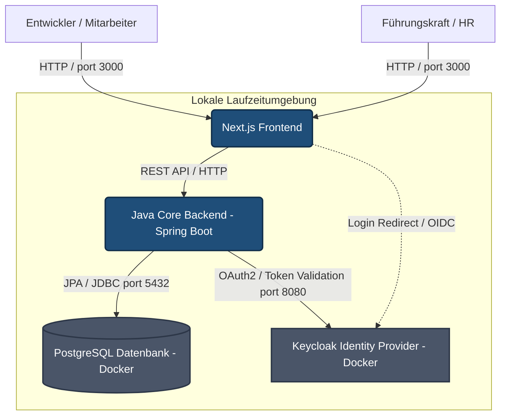

# 3. Kontextabgrenzung

Die Kontextabgrenzung definiert die Außengrenzen der Skillmatrix. Sie beschreibt, welche Akteure (Benutzer) und Nachbarsysteme mit der Anwendung interagieren und über welche Kanäle der Datenaustausch stattfindet.

## 3.1 Fachlicher und technischer Kontext

Da die Anwendung vollständig lokal betrieben wird, befinden sich das Hauptsystem sowie die gesamte Daten- und Identitätsinfrastruktur innerhalb derselben lokalen Umgebung (Entwickler-Laptop):

## 3.2 Schnittstellenbeschreibung

In der folgenden Tabelle werden die Schnittstellen nach außen sowie zwischen den Hauptkomponenten im Detail definiert:

| Nachbarsystem / Akteur / Komponente | Richtung | Protokoll / Medium | Beschreibung |
| :--- | :--- | :--- | :--- |
| **Mitarbeiter & Führungskräfte** | Eingehend | HTTP / Localhost (Port 3000) | Greifen über den Webbrowser auf das Next.js-Frontend zu, um Daten einzusehen oder zu pflegen. |
| **Next.js Frontend ↔ Spring Boot** | Bidirektional | HTTP REST / JSON | Das Frontend ruft die REST-Endpunkte des Backends auf. Anfragen werden durch das Mitschicken des von Keycloak ausgestellten Bearer-Tokens (JWT) im HTTP-Header autorisiert. |
| **Keycloak (Identity Provider)** | Ausgehend | OpenID Connect (OIDC) / OAuth2 (Port 8080) | Verwaltet Benutzer und Rollen. Das Frontend leitet für den Login dorthin weiter. Das Spring Boot Backend validiert eingehende Token kryptografisch gegen Keycloak, um die Rechte zu prüfen. |
| **PostgreSQL Datenbank** | Ausgehend | PostgreSQL-Protokoll (Port 5432) | Die primäre Datenquelle für Profile, Skills und Fragen. **Ausschließlich das Spring Boot Backend** greift via JPA/Hibernate direkt auf die Datenbank zu. Das Frontend hat keinen Direktzugriff. |
